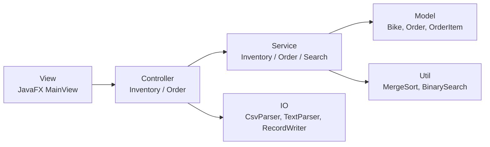

# Bike Store Inventory & Order Processing System

A desktop application for managing a bike shop's inventory and orders, written in Java 25
with JavaFX. Built around the MVC pattern, with custom parsing, sorting and searching
algorithms instead of library shortcuts.

## Features

- Load and save inventory from **CSV** or a structured **key=value text** format
- Validation with per-line error reports (bad rows are skipped, not fatal)
- Filter by category, price range and availability
- Create orders with stock checks and automatic rollback if something fails
- JavaFX table UI bound to the backend through an `ObservableList`

## Architecture



| Package | Responsibility |
|---|---|
| `model` | Domain objects with validation in constructors |
| `io` | Parsing, validation and serialization (CSV and text) |
| `util` | Generic `MergeSort` and `BinarySearch` (with lower/upper bound) |
| `service` | Business logic: inventory, orders, indexed search |
| `controller` | Connects UI events to services |
| `view` | JavaFX UI |

## Algorithms

`SearchService` keeps the inventory sorted four ways (id, price, category, stock) using a
custom stable **Merge Sort** (O(n log n)). Lookups use **Binary Search** (O(log n)), and
range queries use lower/upper bound searches to find the slice of matching records
without scanning the list. Indexes are rebuilt after every data change.

### Benchmark

100,000 generated records, 2,000 queries, measured on Intel Core i5-13500H, 16 GB RAM, Windows, JDK 25:

| Query | Linear scan | Binary search | Speedup |
|---|---|---|---|
| Lookup by id | 200 ms | 1.6 ms | ~127x |
| Price range | 1088 ms | 2.8 ms | ~386x |

Building all four indexes takes about 240 ms (one-time cost per data change).
Run it with `com.bikestore.Benchmark` (in `src/test`).

## Data formats

CSV:

```csv
id,name,category,price,stock
1,Trek Marlin 5,MOUNTAIN,549.99,12
```

Text (records separated by a blank line):

```
id=1
name=Trek Marlin 5
category=MOUNTAIN
price=549.99
stock=12
```

Limitation: the CSV parser does not support commas inside quoted fields.

## Getting started

Requirements: JDK 25 and Maven.

```
mvn test          # run the unit tests
mvn javafx:run    # start the application
```

The app loads `data/bikes.csv` on startup. Use `data/broken.csv` to see how
invalid records are reported.

## Tests

JUnit 5 tests cover the parsers (valid and malformed input), CSV and text round-trips,
sorting and search (compared against `Collections.sort` and linear scan), and order
processing (stock deduction, rollback, validation).